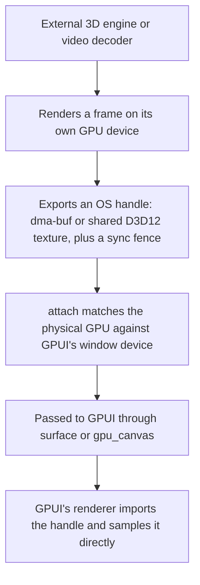

# gpui_interop

Display frames rendered by external graphics engines, hardware video decoders, or separate processes
directly inside a GPUI window without copying pixels through the CPU.


*The `interop_cube_drag` example: a separate Vulkan renderer draws the 3D cube and passes it to GPUI as
a `dma-buf`. GPUI composites the transparent frame directly into the scene, drawing the background tiles
underneath it and the UI panel and buttons on top.*

Normally, GPUI can only sample textures that live on its own GPU device. If you are embedding a 3D
engine (such as a custom Vulkan renderer or a `wgpu` viewport) or a hardware video decoder (like
[`gpui_video`](https://github.com/bite-gpui/gpui_video)) that manages its own GPU device, standard
texture sharing will not work without downloading the frame to system RAM and re-uploading it.

`gpui_interop` avoids that CPU round-trip. Your renderer draws a frame on its own device, exports an
OS-level handle (a `dma-buf` on Linux or a shared texture on Windows), and passes it to GPUI's
`surface()` element. GPUI's renderer imports that handle and samples the texture directly on the GPU.

> **Note:** You only need this crate when your renderer uses its own separate GPU device. If your code
> can draw directly on GPUI's device, use GPUI's built-in rendering APIs instead.

## Common use cases

* **Hardware video playback:** Decoding video frames straight to hardware surfaces (VA-API, NVDEC,
  D3D12 Video) and displaying them in a GPUI player without stalling the CPU (used by
  [`gpui_video`](https://github.com/bite-gpui/gpui_video)).
* **Embedded 3D viewports:** Running a standalone 3D engine (such as a CAD viewer, level editor, or
  `wgpu` scene) in its own render loop and compositing its output into a GPUI panel.
* **Emulators and capture pipelines:** Streaming frames from a game emulator, screen-capture tool, or
  external process directly into a GPUI interface.

## Supported platforms

| Platform | Handle types | How it works |
| --- | --- | --- |
| **Linux** | `SharedBuffer` → `gpui::DmaBufHandle` | Exports a Vulkan image as a `dma-buf` with its DRM format modifier (linear or driver-tiled, single-plane or two-plane NV12). `SharedBuffer::new` lets the driver choose the layout; `SharedBuffer::export_at` pushes one the producer declares, which is the shape a decoder or a canonical DRM buffer needs. Frame synchronization is handled by a `Fence` that exports a `sync_file`. |
| **Windows** | `SharedSurface` + `Fence` | Exports a shared texture from a Direct3D 12 renderer and opens it on GPUI's Direct3D 11 device, using a shared fence to synchronize the two GPU queues. |
| **macOS** | `IOSurface` | **Not yet implemented.** Planned support will wrap an external renderer's `IOSurface` in an `MTLTexture`. |

## Requirements

* **Linux:** A Vulkan loader (`libvulkan.so.1`) and a driver that supports `dma-buf` export
  (`VK_EXT_external_memory_dma_buf` and `VK_EXT_image_drm_format_modifier`). On Debian or Ubuntu:

  ```sh
  sudo apt-get install -y libvulkan1 mesa-vulkan-drivers
  ```

  Installing `mesa-vulkan-drivers` provides `lavapipe` (a software Vulkan implementation) so unit tests
  can run in CI. Tests that require `dma-buf` export automatically skip if the active driver does not
  support it.
* **Windows:** Direct3D 11 and Direct3D 12 support. The cross-device tests run on Microsoft's WARP
  software adapter, so a physical GPU is not required in CI.
* **Rust:** A recent toolchain supporting the 2024 edition.

## Quick start

You set up the bridge inside GPUI's `gpu_canvas` callback, which gives you access to the window's active
renderer and underlying GPU device:

```rust
use gpui_interop::{attach, Unavailable};

fn bridge(gpu: &mut gpui::GpuCanvasContext) -> Result<(), Unavailable> {
    // 1. Connect to the window's active renderer.
    let interop = attach(gpu.try_device::<gpui::DirectXRenderer>())?;

    // 2. Get a wgpu device and queue on the same physical GPU (requires the `wgpu` feature).
    let (device, queue) = interop.adapter().wgpu().expect("no matching GPU adapter found");

    // 3. Render your 3D scene or video frame on `device`, then pass the exported surface to GPUI
    //    through the `surface()` element (or `gpu_canvas`'s own `paint_surface`).
    Ok(())
}
```

The snippet above shows the Windows setup using `gpui::DirectXRenderer` and `Adapter::wgpu()`. On Linux,
the window uses `gpui_wgpu::WgpuRenderer`, and you obtain your device from
`interop.adapter().gpu_device()` instead — which creates a `dma-buf`-capable Vulkan device on the same
physical GPU (see the Linux code example below).

If the canvas does not expose a compatible hardware device (for example, when running in an offscreen
test or an unsupported renderer), `attach` returns `Err(Unavailable::NoDevice)` instead of panicking so
your application can fall back cleanly.

## Examples

Three Linux examples show how to pass frames and input between an external renderer and GPUI. Build and
run them with the `example` feature:

| Example | Description |
| --- | --- |
| `interop_linux` | Minimal setup: clears two `SharedBuffer` textures on a separate GPU device (one linear, one driver-tiled), exports them as `dma-buf` handles, and draws them as tiles in a GPUI window. |
| `interop_cube` | Embedded 3D engine: an independent Vulkan pipeline renders a spinning cube into a `SharedBuffer` and composites it into GPUI with zero CPU copies. |
| `interop_cube_drag` | Interactive 3D viewport: lets you rotate the spinning cube by clicking and dragging via `surface_input`. Mouse drags continue tracking even if the cursor leaves the viewport, while GPUI buttons overlaid on top still receive normal clicks. |

```sh
cargo run -p gpui_interop --example interop_linux     --features example
cargo run -p gpui_interop --example interop_cube      --features example
cargo run -p gpui_interop --example interop_cube_drag --features example
```

### The Linux `dma-buf` path in code

`interop_linux` demonstrates the minimal setup on Linux: attach to the window renderer's GPU, allocate
and clear a shareable texture, and pass its handle to the GPUI scene. (The example creates two textures:
one linear and one driver-tiled.)

```rust
use std::cell::RefCell;
use std::rc::Rc;

use gpui::{GpuCanvasContext, IntoElement, SurfaceFormatKind, gpu_canvas};
use gpui_interop::{GpuDevice, SharedBuffer, Tiling, attach};
use gpui_wgpu::WgpuRenderer;

/// Holds the producer's buffers for the lifetime of the window.
///
/// Note: Rust drops struct fields in declaration order. Because each `SharedBuffer`
/// frees its memory through the `GpuDevice` it was allocated on, `_device` must be
/// declared last so the buffers are dropped before the device itself.
struct Tiles {
    linear: SharedBuffer,
    tiled: SharedBuffer,
    _device: GpuDevice,
}

impl Tiles {
    /// Connects to the window renderer's GPU (or falls back to opening a standalone
    /// device if the window does not expose one) and initializes both buffers.
    fn build(gpu: &mut GpuCanvasContext) -> Option<Self> {
        let device = attach(gpu.try_device::<WgpuRenderer>())
            .ok()
            .and_then(|interop| interop.adapter().gpu_device())
            .or_else(|| GpuDevice::open().ok())?;
        let linear = cleared(&device, Tiling::Linear, [0.85, 0.35, 0.13, 1.0]).ok()?;
        let tiled = cleared(&device, Tiling::Tiled, [0.13, 0.62, 0.58, 1.0]).ok()?;
        Some(Self { linear, tiled, _device: device })
    }
}

/// Allocates a 192×192 `bgra8` image with the given tiling and clears it to `colour`.
fn cleared(device: &GpuDevice, tiling: Tiling, colour: [f32; 4]) -> anyhow::Result<SharedBuffer> {
    let buffer = SharedBuffer::new(device, 192, 192, SurfaceFormatKind::bgra8(), tiling)?;
    buffer.clear(device, colour)?;
    Ok(buffer)
}

/// Initializes the shared buffers on the first paint and composites the selected tile on every frame.
fn tile(slot: Rc<RefCell<Option<Tiles>>>, pick: fn(&Tiles) -> &SharedBuffer) -> impl IntoElement {
    gpu_canvas(move |gpu: &mut GpuCanvasContext| {
        let mut slot = slot.borrow_mut();
        if slot.is_none() {
            *slot = Tiles::build(gpu);
        }
        if let Some(tiles) = slot.as_ref() {
            gpu.paint_surface(pick(tiles).handle());
        }
    })
}
```

### When the layout comes from somewhere else

A decoder, a camera or a canonical DRM buffer already has a plane layout, and on some GPUs the
driver's own linear layout pads it (an NVIDIA 930M puts `NV12` chroma at 65,536 bytes rather than
4,096). Ask the device what it will actually sample **before** allocating:

```rust
// The layout this device gives a plain LINEAR image, and the bytes that image needs.
let format = SurfaceFormatKind::nv12();
let layout = device.linear_layout(format, width, height, &planes)?;
// ...place the planes at `layout.native` and allocate at least `layout.required` bytes...
let buffer = SharedBuffer::export_at(&device, width, height, format, &layout.native, bytes)?;
```

`export_at` allocates device-local memory and stages the producer's bytes into it, because the NVIDIA
driver faults on a host-visible exportable allocation. It also records that the buffer is written at
export, so `clear` and `fill` refuse it.

The transfer curve is separate from the layout: a buffer holding display-encoded values (sRGB bytes,
or BT.709 `R'G'B'`) is the default, and one holding linear light declares it with
`SharedBuffer::with_transfer(TransferFunction::Linear)`. `TransferFunction` is `gpui::TransferFunction`.

## How it works under the hood



Zero-copy sharing only works when the external renderer and GPUI run on the **same physical GPU**.
Graphics APIs cannot share a memory handle across two different cards (such as an integrated GPU and a
discrete GPU) without copying through system RAM, so `gpui_interop` verifies the hardware match up
front:

1. `attach` inspects the device handle provided by GPUI's `gpu_canvas` callback and returns an `Interop`
   instance.
2. `Interop::adapter` identifies the exact physical GPU driving the window:
   * **On Windows:** It matches the adapter's hardware `LUID` (Locally Unique Identifier). Matching by
     adapter name is unreliable because DXGI and `wgpu` can enumerate a different number of
     `Microsoft Basic Render Driver` (WARP) entries with identical names, whereas hardware LUIDs never
     collide.
   * **On Linux:** It queries the renderer's `vk::PhysicalDevice`. Calling `Adapter::gpu_device` then
     creates a second logical Vulkan device on that same physical card, ensuring your producer's render
     queue never races with GPUI's queue.
3. If no matching physical GPU is found, the adapter call returns `None` rather than guessing which card
   to use (`Adapter::wgpu` on Windows, `Adapter::gpu_device` on Linux). A producer that runs off the
   paint — a decoder or capture thread — reads the GPU identity after a canvas has run once through
   `gpui_interop::gpu_id()`; `Adapter::gpu_id` remembers it.

## Choosing the GPU

The same-GPU rule decides whether a producer can exist at all, so the GPU is chosen **once, for the
process, before the first window** — `GpuPreference` on `Application`. There is no runtime switch: a
settings change applies on the next launch. (A [`Guest`](#guest-mode-gpui-inside-a-host-loop) states
the same choice in its renderer factory, because its headless context is what creates the device.)

| preference | use it when |
| --- | --- |
| `LowPower` (the default) | the producer does not need the discrete GPU. On a hybrid laptop this is the panel's GPU, so the window never wakes the dGPU. |
| `HighPerformance` | a 3D engine or CAD viewport wants the discrete GPU. The renderer follows it, and the producer shares its device. |
| `Device(GpuId)` | a saved choice from a settings panel. Store the id's **permanent** part; the session handle is skipped when serialised. |
| `Custom(predicate)` | the requirement is not a device class — a hardware decoder (`gpui_va::decode_preference`), a minimum Vulkan feature, another capability the adapter list does not state. |

`HighPerformance`, `Device` and `Custom` are **preferences, not pins**: if the display cannot be
configured on the chosen adapter (or a saved card is gone), the renderer falls back to `Auto`'s order.
Read `App::active_gpu()` once the first window exists to confirm what was actually chosen.

### A CAD viewport on the discrete GPU

A CAD engine is a producer that owns its device: it wants the fast GPU, and the renderer must be on
that same GPU or the shared handle cannot be opened on the renderer's device. State that before the
first window:

```rust
use gpui::GpuPreference;

let app = gpui::application().with_gpu_preference(GpuPreference::HighPerformance);
```

Inside the view's `gpu_canvas`, `attach` lands the engine on the renderer's own GPU. The renderer type
is platform-specific — `WgpuRenderer` on Linux, `DirectXRenderer` on Windows:

```rust
// Linux: the window's renderer is `WgpuRenderer`.
let interop = gpui_interop::attach(gpu.try_device::<gpui_wgpu::WgpuRenderer>())?;
let device = interop.adapter().gpu_device(); // a dma-buf-capable Vulkan device on the renderer's GPU
// ... or, for an engine that owns its own device, the identity to match:
// let gpu = interop.adapter().gpu_id();

// Windows: the window's renderer is `DirectXRenderer`, and `wgpu` matches its adapter by LUID.
// let interop = gpui_interop::attach(gpu.try_device::<gpui::DirectXRenderer>())?;
// let (device, queue) = interop.adapter().wgpu().expect("the renderer's adapter");
```

Keep the default `LowPower` when the engine does not need the dGPU: a renderer on the discrete GPU
keeps it powered for the window's lifetime and crosses PCIe to the panel on every frame. Check
`active_gpu()` if the engine has hard requirements; a silent fallback to the integrated GPU means the
engine should either run there or fall back to a CPU copy.

### A user-chosen adapter

A preferences panel lists `enumerate_gpus()` and stores the chosen adapter's `GpuId`. Serialisation
keeps the permanent part and drops the session handle, so the stored value re-resolves on the next
boot through `Device`:

```rust
use gpui::{GpuId, GpuPreference};

// In the settings panel: `chosen: &GpuAdapterInfo`.
let saved = serde_json::to_string(&chosen.id)?;

// At startup, before the first window.
let preference = match saved_config.as_deref() {
    Some(saved) => GpuPreference::Device(serde_json::from_str::<GpuId>(saved)?),
    None => GpuPreference::LowPower,
};
let app = gpui::application().with_gpu_preference(preference);
```

`Device` matches the permanent part (PCI ids, a PnP id, or a name) and falls back to `Auto` when the
card is absent — another reason to read `active_gpu()` after the window. The panel cannot switch the
renderer live: persist the choice and tell the user it applies on the next launch.

### A capability-based choice

When the requirement is not a device class, express it as a predicate over the enumerated list. A
CAD engine that wants a discrete Vulkan device says so directly; `gpui_va::decode_preference` is the
same shape for a decoder requirement.

```rust
use std::sync::Arc;
use gpui::{GpuAdapterInfo, GpuBackend, GpuDeviceType, GpuPreference};

let preference = GpuPreference::Custom(Arc::new(|gpus: &[GpuAdapterInfo]| {
    gpus.iter().position(|gpu| {
        gpu.device_type == GpuDeviceType::Discrete && gpu.backend == GpuBackend::Vulkan
    })
}));
```

The predicate returns **one** index. `None`, or an index past the list, fails the window naming the
shortfall rather than silently drawing on a GPU the application did not choose.

### Mapping an adapter to a producer

On Linux, `gpui_interop::GpuId::from_adapter` (behind the crate's `gpui` feature) maps an enumerated
`GpuAdapterInfo` to the producer's identity — the device name and DRM render node — and
`GpuId::matches_adapter` is the name join a predicate can use without opening anything. Inside a
canvas, `Adapter::gpu_id` confirms the renderer's GPU and remembers it for a producer off the paint
(`gpui_interop::gpu_id()`). On Windows the identity is the adapter LUID, which `Adapter::wgpu` matches
internally for a producer that can render on wgpu; a producer that must own its own Direct3D 12
device needs that LUID and the crate does not expose it yet.

### What can only be checked after the device exists

`GpuAdapterInfo` deliberately carries no capabilities: proving one creates a device, which is the
cost enumeration exists to avoid. Once the first window has made the renderer's device,
`App::dmabuf_capabilities()` reports the formats and DRM modifiers the renderer will import, and
`gpui_interop::GpuDevice::linear_layout` reports the plane layout its device gives a linear buffer.
Use those to choose the producer's layout, and `App::active_gpu()` to confirm the choice. A platform
whose surfaces are not dma-bufs returns `None`.

## Guest mode: GPUI inside a host loop

The crate also works in the opposite direction. With the `guest` feature, `gpui_interop::Guest` runs a
headless GPUI app on a worker thread for a host that owns its own window and presents through another
API. Nothing about the guest's renderer crosses the thread: the host asks for a frame, the guest draws
and presents it, and the renderer's shareable surface comes back.

```rust
use gpui::PlatformRenderer;
use gpui_interop::{Guest, GuestOptions};
use gpui_wgpu::{WgpuHeadlessRenderer, WgpuOffscreenSurface};

let mut guest = Guest::spawn(
    GuestOptions { size: size(px(1280.), px(720.)) },
    || Ok(Box::new(WgpuHeadlessRenderer::new()?) as Box<dyn PlatformRenderer>),
    |_window, cx| cx.new(|_| MyView),
)?;

// Each turn of the host's loop:
let frame = guest.request_frame(None)?;
let surface = frame.surface().downcast_ref::<WgpuOffscreenSurface>();
// sample surface.texture() on the same wgpu device

// Work and input go back the other way, in order:
guest.update(|window, cx| { /* ... */ })?;
```

Frames are drawn only when the host asks, so the host's cadence wins; the guest's animations and async
tasks simply mark the window dirty until the next request. `request_frame` errors when the renderer has
no shareable surface, so a CPU-only backend fails where the GPU path is asked for instead of silently
returning an empty frame.

The renderer is the caller's, so the sample above uses `gpui_wgpu`'s headless renderer (the
`headless` feature of `gpui_wgpu`); any renderer that answers `PlatformRenderer` and exposes an
`offscreen_surface_handle` works. `WgpuHeadlessRenderer::with_gpu_preference` pins the guest to a GPU,
and the headless context is process-wide, so the host that samples joins the same device rather than
opening a second one. The guest seam (`Window::present`, the headless window honouring a renderer
factory) is newer than the last published core, so this feature currently needs the `bite_v1.23.x`
working tree — see the next section.

## Cargo features

| Feature | Description |
| --- | --- |
| *(default)* | Core library and platform transport types (`SharedBuffer`, `SharedSurface`, `Fence`) for Linux and Windows. |
| `wgpu` | Enables `Adapter::wgpu`, which initializes a `wgpu::Device` and `wgpu::Queue` on the same physical GPU as the GPUI window. |
| `gpui` | Enables the viewport input helpers (`surface_input`, `SurfaceInput`, `SurfaceEvent`, `SurfacePoint`) for routing pointer events into an embedded 3D scene or video player. |
| `example` | Enables the dependencies needed to build and run the Linux window examples on top of `wgpu`. |
| `readback-test` | Enables the headless GPU compositing and pixel read-back integration test. |
| `input-test` | Enables headless tests that route pointer events through `surface_input`. |
| `guest` | Enables `Guest`, the headless worker-thread runner that hands frames to a foreign host loop, with a command channel back. The renderer comes from the caller, so a test build also needs a backend such as `gpui_wgpu`'s `headless` feature. |
| `guest-test` | Enables the guest runner's GPU integration test. |

## Using with `bite-gpui`

During development this workspace takes the core from the sibling checkout — `gpui`, `gpui_engine`,
`gpui_wgpu` and `gpui_windows` are path dependencies on `../bite-gpui/crates/…` — so a fix in the
renderer reaches this stack without a release. On release each path becomes the published package.

The last published release is `1.23.302`. A consumer aliases the published packages back to their
standard crate names so imports like `use gpui::...` compile unchanged:

```toml
[workspace.dependencies]
gpui         = { package = "bite-gpui",       version = "1.23.302", default-features = false }
gpui_engine  = { package = "bite-gp-engine",  version = "1.23.302" }
gpui_wgpu    = { package = "bite-gp-wgpu",    version = "1.23.302" }
gpui_windows = { package = "bite-gp-windows", version = "1.23.302" }
```

The crate's current line needs core additions that are on `bite_v1.23.x` **after** that tag: the
guest seams (a public `Window::present`, the headless renderer factory, the offscreen surface
handle), the dma-buf explicit-layout guard, and the transfer function. Until the next amendment to
the `1.23` line is published, point at the branch or a checkout instead:

```toml
[workspace.dependencies]
gpui         = { path = "../bite-gpui/crates/gpui", default-features = false }
gpui_engine  = { path = "../bite-gpui/crates/gpui_engine" }
gpui_wgpu    = { path = "../bite-gpui/crates/gpui_wgpu" }
gpui_windows = { path = "../bite-gpui/crates/gpui_windows" }
```

To test against a custom GPUI branch, replace those paths with `git`/`branch` sources.

## Running the tests

```sh
# Linux unit tests (headless): tests linear and tiled dma-buf exports, two-plane NV12 buffers,
# sync_file fence exports, and buffer clearing via libvulkan.so.1.
cargo test -p gpui_interop

# Optional integration tests (each opens a window):
cargo test -p gpui_interop --features readback-test   # composites a buffer in GPUI and reads the pixels back
cargo test -p gpui_interop --features input-test      # routes pointer events through surface_input
cargo test -p gpui_interop --features guest-test      # a worker thread hands a frame to the host loop

# The GPU-backed suites need a Vulkan adapter. On a machine with more than one GPU, pin the PCI
# device id with `ZED_DEVICE_ID` (the guest and read-back suites both honour it):
ZED_DEVICE_ID=1916 cargo test -p gpui_interop --features guest-test --test guest_runner -- --test-threads=1

# Windows integration test: composites a shared D3D12 texture on GPUI's D3D11 renderer.
cargo test -p gpui_interop a_shared_d3d12_surface
```

## Repository structure

```
Cargo.toml                        Workspace configuration and bite-gpui dependencies
crates/gpui_interop/
  src/adapter.rs                  Adapter / Unavailable: matches an external GPU device to GPUI's renderer
  src/linux.rs                    Linux dma-buf support: SharedBuffer, GpuDevice, GpuId, Tiling, Fence
  src/windows.rs                  Windows D3D12 support: SharedSurface, Fence
  src/macos.rs                    macOS IOSurface stub (not yet implemented)
  src/guest.rs                    Guest: headless GPUI on a worker thread, handing frames to a host loop
  src/input.rs                    Input routing for interactive viewports and surfaces
  tests/                          Opt-in integration suites: guest_runner, linux_dmabuf_readback, surface_input
  examples/                       Linux demos: interop_linux, interop_cube, interop_cube_drag
```

## Status

This crate is **experimental** and under active development. Expect breaking API changes as additional
platform backends (such as macOS `IOSurface`) are implemented.

## License

Licensed under the Apache-2.0 License. See `Cargo.toml` for details.
