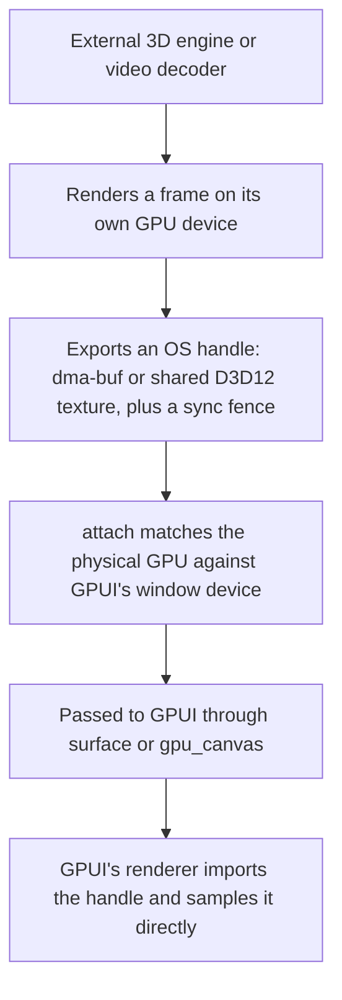

# gpui_interop

Display frames rendered by external graphics engines, hardware video decoders, or separate processes
directly inside a GPUI window without copying pixels through the CPU.


*The `interop_cube_drag` example: a separate Vulkan renderer draws the 3D cube and passes it to GPUI as
a `dma-buf`. GPUI composites the transparent frame directly into the scene, drawing the background tiles
underneath it and the UI panel and buttons on top.*

Normally, GPUI can only sample textures that live on its own GPU device. If you are embedding a 3D
engine (such as a custom Vulkan renderer or a `wgpu` viewport) or a hardware video decoder (like
[`gpui_video`](https://github.com/bite-gpui/gpui_video)) that manages its own GPU device, standard
texture sharing will not work without downloading the frame to system RAM and re-uploading it.

`gpui_interop` avoids that CPU round-trip. Your renderer draws a frame on its own device, exports an
OS-level handle (a `dma-buf` on Linux or a shared texture on Windows), and passes it to GPUI's
`surface()` element. GPUI's renderer imports that handle and samples the texture directly on the GPU.

> **Note:** You only need this crate when your renderer uses its own separate GPU device. If your code
> can draw directly on GPUI's device, use GPUI's built-in rendering APIs instead.

## Common use cases

* **Hardware video playback:** Decoding video frames straight to hardware surfaces (VA-API, NVDEC,
  D3D12 Video) and displaying them in a GPUI player without stalling the CPU (used by
  [`gpui_video`](https://github.com/bite-gpui/gpui_video)).
* **Embedded 3D viewports:** Running a standalone 3D engine (such as a CAD viewer, level editor, or
  `wgpu` scene) in its own render loop and compositing its output into a GPUI panel.
* **Emulators and capture pipelines:** Streaming frames from a game emulator, screen-capture tool, or
  external process directly into a GPUI interface.

## Supported platforms

| Platform | Handle types | How it works |
| --- | --- | --- |
| **Linux** | `SharedBuffer` → `gpui::DmaBufHandle` | Exports a Vulkan image as a `dma-buf` with its DRM format modifier (linear or driver-tiled, single-plane or two-plane NV12). Frame synchronization is handled by a `Fence` that exports a `sync_file`. |
| **Windows** | `SharedSurface` + `Fence` | Exports a shared texture from a Direct3D 12 renderer and opens it on GPUI's Direct3D 11 device, using a shared fence to synchronize the two GPU queues. |
| **macOS** | `IOSurface` | **Not yet implemented.** Planned support will wrap an external renderer's `IOSurface` in an `MTLTexture`. |

## Requirements

* **Linux:** A Vulkan loader (`libvulkan.so.1`) and a driver that supports `dma-buf` export
  (`VK_EXT_external_memory_dma_buf` and `VK_EXT_image_drm_format_modifier`). On Debian or Ubuntu:

  ```sh
  sudo apt-get install -y libvulkan1 mesa-vulkan-drivers
  ```

  Installing `mesa-vulkan-drivers` provides `lavapipe` (a software Vulkan implementation) so unit tests
  can run in CI. Tests that require `dma-buf` export automatically skip if the active driver does not
  support it.
* **Windows:** Direct3D 11 and Direct3D 12 support. The cross-device tests run on Microsoft's WARP
  software adapter, so a physical GPU is not required in CI.
* **Rust:** A recent toolchain supporting the 2024 edition.

## Quick start

You set up the bridge inside GPUI's `gpu_canvas` callback, which gives you access to the window's active
renderer and underlying GPU device:

```rust
use gpui_interop::{attach, Unavailable};

fn bridge(gpu: &mut gpui::GpuCanvasContext) -> Result<(), Unavailable> {
    // 1. Connect to the window's active renderer.
    let interop = attach(gpu.try_device::<gpui::DirectXRenderer>())?;

    // 2. Get a wgpu device and queue on the same physical GPU (requires the `wgpu` feature).
    let (device, queue) = interop.adapter().wgpu().expect("no matching GPU adapter found");

    // 3. Render your 3D scene or video frame on `device`, then pass the exported surface to GPUI
    //    through the `surface()` element (or `gpu_canvas`'s own `paint_surface`).
    Ok(())
}
```

The snippet above shows the Windows setup using `gpui::DirectXRenderer` and `Adapter::wgpu()`. On Linux,
the window uses `gpui_wgpu::WgpuRenderer`, and you obtain your device from
`interop.adapter().gpu_device()` instead — which creates a `dma-buf`-capable Vulkan device on the same
physical GPU (see the Linux code example below).

If the canvas does not expose a compatible hardware device (for example, when running in an offscreen
test or an unsupported renderer), `attach` returns `Err(Unavailable::NoDevice)` instead of panicking so
your application can fall back cleanly.

## Examples

Three Linux examples show how to pass frames and input between an external renderer and GPUI. Build and
run them with the `example` feature:

| Example | Description |
| --- | --- |
| `interop_linux` | Minimal setup: clears two `SharedBuffer` textures on a separate GPU device (one linear, one driver-tiled), exports them as `dma-buf` handles, and draws them as tiles in a GPUI window. |
| `interop_cube` | Embedded 3D engine: an independent Vulkan pipeline renders a spinning cube into a `SharedBuffer` and composites it into GPUI with zero CPU copies. |
| `interop_cube_drag` | Interactive 3D viewport: lets you rotate the spinning cube by clicking and dragging via `surface_input`. Mouse drags continue tracking even if the cursor leaves the viewport, while GPUI buttons overlaid on top still receive normal clicks. |

```sh
cargo run -p gpui_interop --example interop_linux     --features example
cargo run -p gpui_interop --example interop_cube      --features example
cargo run -p gpui_interop --example interop_cube_drag --features example
```

### The Linux `dma-buf` path in code

`interop_linux` demonstrates the minimal setup on Linux: attach to the window renderer's GPU, allocate
and clear a shareable texture, and pass its handle to the GPUI scene. (The example creates two textures:
one linear and one driver-tiled.)

```rust
use std::cell::RefCell;
use std::rc::Rc;

use gpui::{GpuCanvasContext, IntoElement, SurfaceFormatKind, gpu_canvas};
use gpui_interop::{GpuDevice, SharedBuffer, Tiling, attach};
use gpui_wgpu::WgpuRenderer;

/// Holds the producer's buffers for the lifetime of the window.
///
/// Note: Rust drops struct fields in declaration order. Because each `SharedBuffer`
/// frees its memory through the `GpuDevice` it was allocated on, `_device` must be
/// declared last so the buffers are dropped before the device itself.
struct Tiles {
    linear: SharedBuffer,
    tiled: SharedBuffer,
    _device: GpuDevice,
}

impl Tiles {
    /// Connects to the window renderer's GPU (or falls back to opening a standalone
    /// device if the window does not expose one) and initializes both buffers.
    fn build(gpu: &mut GpuCanvasContext) -> Option<Self> {
        let device = attach(gpu.try_device::<WgpuRenderer>())
            .ok()
            .and_then(|interop| interop.adapter().gpu_device())
            .or_else(|| GpuDevice::open().ok())?;
        let linear = cleared(&device, Tiling::Linear, [0.85, 0.35, 0.13, 1.0]).ok()?;
        let tiled = cleared(&device, Tiling::Tiled, [0.13, 0.62, 0.58, 1.0]).ok()?;
        Some(Self { linear, tiled, _device: device })
    }
}

/// Allocates a 192×192 `bgra8` image with the given tiling and clears it to `colour`.
fn cleared(device: &GpuDevice, tiling: Tiling, colour: [f32; 4]) -> anyhow::Result<SharedBuffer> {
    let buffer = SharedBuffer::new(device, 192, 192, SurfaceFormatKind::bgra8(), tiling)?;
    buffer.clear(device, colour)?;
    Ok(buffer)
}

/// Initializes the shared buffers on the first paint and composites the selected tile on every frame.
fn tile(slot: Rc<RefCell<Option<Tiles>>>, pick: fn(&Tiles) -> &SharedBuffer) -> impl IntoElement {
    gpu_canvas(move |gpu: &mut GpuCanvasContext| {
        let mut slot = slot.borrow_mut();
        if slot.is_none() {
            *slot = Tiles::build(gpu);
        }
        if let Some(tiles) = slot.as_ref() {
            gpu.paint_surface(pick(tiles).handle());
        }
    })
}
```

## How it works under the hood



Zero-copy sharing only works when the external renderer and GPUI run on the **same physical GPU**.
Graphics APIs cannot share a memory handle across two different cards (such as an integrated GPU and a
discrete GPU) without copying through system RAM, so `gpui_interop` verifies the hardware match up
front:

1. `attach` inspects the device handle provided by GPUI's `gpu_canvas` callback and returns an `Interop`
   instance.
2. `Interop::adapter` identifies the exact physical GPU driving the window:
   * **On Windows:** It matches the adapter's hardware `LUID` (Locally Unique Identifier). Matching by
     adapter name is unreliable because DXGI and `wgpu` can enumerate a different number of
     `Microsoft Basic Render Driver` (WARP) entries with identical names, whereas hardware LUIDs never
     collide.
   * **On Linux:** It queries the renderer's `vk::PhysicalDevice`. Calling `Adapter::gpu_device` then
     creates a second logical Vulkan device on that same physical card, ensuring your producer's render
     queue never races with GPUI's queue.
3. If no matching physical GPU is found, the adapter call returns `None` rather than guessing which card
   to use.

## Cargo features

| Feature | Description |
| --- | --- |
| *(default)* | Core library and platform transport types (`SharedBuffer`, `SharedSurface`, `Fence`) for Linux and Windows. |
| `wgpu` | Enables `Adapter::wgpu`, which initializes a `wgpu::Device` and `wgpu::Queue` on the same physical GPU as the GPUI window. |
| `gpui` | Enables the viewport input helpers (`surface_input`, `SurfaceInput`, `SurfaceEvent`, `SurfacePoint`) for routing pointer events into an embedded 3D scene or video player. |
| `example` | Enables the dependencies needed to build and run the Linux window examples on top of `wgpu`. |
| `readback-test` | Enables the headless GPU compositing and pixel read-back integration test. |
| `input-test` | Enables headless tests that route pointer events through `surface_input`. |

## Using with `bite-gpui` 1.23.301

This workspace pulls GPUI from `crates.io` rather than a git branch. In `Cargo.toml`, the published
`bite-gpui` packages are aliased back to their standard crate names so imports like `use gpui::...`
compile unchanged:

```toml
[workspace.dependencies]
gpui         = { package = "bite-gpui",       version = "1.23.301", default-features = false }
gpui_engine  = { package = "bite-gp-engine",  version = "1.23.301" }
gpui_wgpu    = { package = "bite-gp-wgpu",    version = "1.23.301" }
gpui_windows = { package = "bite-gp-windows", version = "1.23.301" }
```

To test against a local checkout or a custom GPUI branch, replace those version entries with `path` or
`git`/`branch` sources.

## Running the tests

```sh
# Linux unit tests (headless): tests linear and tiled dma-buf exports, two-plane NV12 buffers,
# sync_file fence exports, and buffer clearing via libvulkan.so.1.
cargo test -p gpui_interop

# Optional integration tests (each opens a window):
cargo test -p gpui_interop --features readback-test   # composites a buffer in GPUI and reads the pixels back
cargo test -p gpui_interop --features input-test      # routes pointer events through surface_input

# Windows integration test: composites a shared D3D12 texture on GPUI's D3D11 renderer.
cargo test -p gpui_interop a_shared_d3d12_surface
```

## Repository structure

```
Cargo.toml                        Workspace configuration and bite-gpui dependencies
crates/gpui_interop/
  src/adapter.rs                  Adapter / Unavailable: matches an external GPU device to GPUI's renderer
  src/linux.rs                    Linux dma-buf support: SharedBuffer, GpuDevice, GpuId, Tiling, Fence
  src/windows.rs                  Windows D3D12 support: SharedSurface, Fence
  src/macos.rs                    macOS IOSurface stub (not yet implemented)
  src/input.rs                    Input routing for interactive viewports and surfaces
  examples/                       Linux demos: interop_linux, interop_cube, interop_cube_drag
```

## Status

This crate is **experimental** and under active development. Expect breaking API changes as additional
platform backends (such as macOS `IOSurface`) are implemented.

## License

Licensed under the Apache-2.0 License. See `Cargo.toml` for details.
