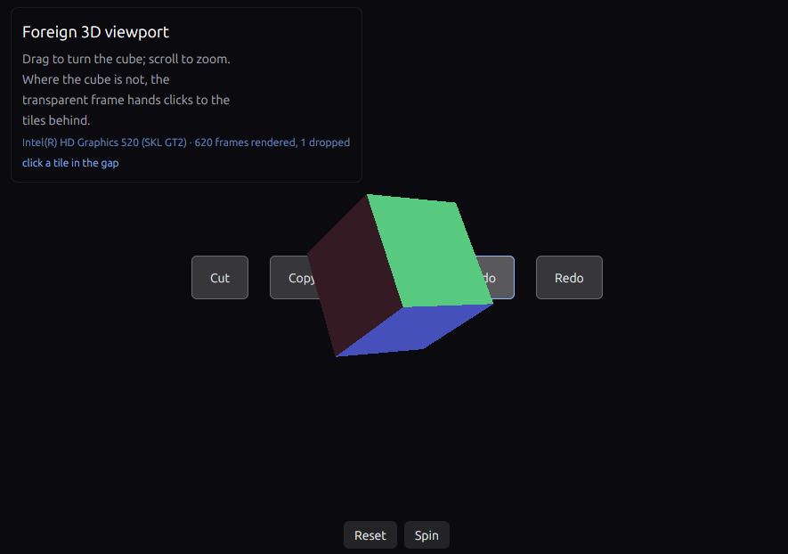
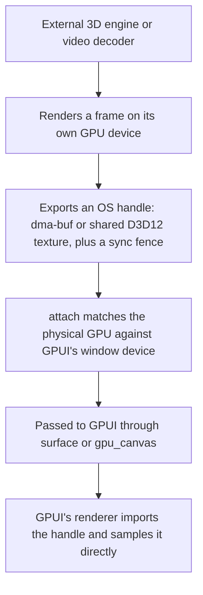

# gpui_interop

Display frames rendered by external graphics engines, hardware video decoders, or separate processes
directly inside a GPUI window without copying pixels through the CPU.



*The `interop_cube_drag` example: a separate Vulkan renderer draws the 3D cube and passes it to GPUI as
a `dma-buf`. GPUI composites the transparent frame directly into the scene, drawing the background tiles
underneath it and the UI panel and buttons on top.*

Normally, GPUI can only sample textures that live on its own GPU device. If you are embedding a 3D
engine (such as a custom Vulkan renderer or a `wgpu` viewport) or a hardware video decoder (like
[`gpui_video`](https://github.com/bite-gpui/gpui_video)) that manages its own GPU device, standard
texture sharing will not work without downloading the frame to system RAM and re-uploading it.

`gpui_interop` avoids that CPU round-trip. Your renderer draws a frame on its own device, exports an
OS-level handle (a `dma-buf` on Linux or a shared texture on Windows), and passes it to GPUI's
`surface()` element. GPUI's renderer imports that handle and samples the texture directly on the GPU.

> **Note:** there are two wgpu shapes. `WgpuSharedBuffer` (Linux) renders into an exportable image and
> hands GPUI a dma-buf with its modifier and a `sync_file` — the cross-device shape a renderer of
> another backend imports. Where the renderer is wgpu, `WgpuSurface` plus `paint_texture` is the
> same-device fast path, with no export and no fence.

## Common use cases

* **Hardware video playback:** Decoding video frames straight to hardware surfaces (VA-API, NVDEC,
  D3D12 Video) and displaying them in a GPUI player without stalling the CPU (used by
  [`gpui_video`](https://github.com/bite-gpui/gpui_video)).
* **Embedded 3D viewports:** Running a standalone 3D engine (such as a CAD viewer, level editor, or
  `wgpu` scene) in its own render loop and compositing its output into a GPUI panel.
* **Emulators and capture pipelines:** Streaming frames from a game emulator, screen-capture tool, or
  external process directly into a GPUI interface.

## Supported platforms

| Platform | Handle types | How it works |
| --- | --- | --- |
| **Linux** | `SharedBuffer` → `gpui::DmaBufHandle` | Exports a Vulkan image as a `dma-buf` with its DRM format modifier (linear or driver-tiled, single-plane or two-plane NV12). `SharedBuffer::new` lets the driver choose the layout; `SharedBuffer::export_at` pushes one the producer declares, which is the shape a decoder or a canonical DRM buffer needs. Frame synchronization is handled by a `Fence` that exports a `sync_file`. |
| **Windows** | `SharedSurface` + `Fence` | Exports a shared texture from a Direct3D 12 renderer and opens it on GPUI's Direct3D 11 device, using a shared fence to synchronize the two GPU queues. |
| **macOS** | `IOSurface` | **Not yet implemented.** Planned support will wrap an external renderer's `IOSurface` in an `MTLTexture`. |

A wgpu producer has two shapes: `WgpuSharedBuffer` exports an offscreen image as a dma-buf that
`paint_surface` imports (the cross-device shape), and `WgpuSurface` is the same-device fast path for
`paint_texture`. Both start from `Adapter::wgpu`. See [wgpu producers](#wgpu-producers).

## Requirements

* **Linux:** A Vulkan loader (`libvulkan.so.1`) and a driver that supports `dma-buf` export
  (`VK_EXT_external_memory_dma_buf` and `VK_EXT_image_drm_format_modifier`). On Debian or Ubuntu:

  ```sh
  sudo apt-get install -y libvulkan1 mesa-vulkan-drivers
  ```

  Installing `mesa-vulkan-drivers` provides `lavapipe` (a software Vulkan implementation) so unit tests
  can run in CI. Tests that require `dma-buf` export automatically skip if the active driver does not
  support it.
* **Windows:** Direct3D 11 and Direct3D 12 support. The cross-device tests run on Microsoft's WARP
  software adapter, so a physical GPU is not required in CI.
* **Rust:** A recent toolchain supporting the 2024 edition.

## Quick start

You set up the bridge inside GPUI's `gpu_canvas` callback, which gives you access to the window's active
renderer and underlying GPU device:

```rust
use gpui_interop::{attach, Unavailable};

fn bridge(gpu: &mut gpui::GpuCanvasContext) -> Result<(), Unavailable> {
    // 1. Connect to the window's active renderer.
    let interop = attach(gpu.try_device::<gpui::DirectXRenderer>())?;

    // 2. A producer that wants wgpu can get a device and queue to render on. Where the attached
    //    renderer is wgpu (Linux; Windows with `WgpuRenderer`) this is that renderer's own pair;
    //    under the Direct3D 11 renderer it is a separate DX12 device on the same adapter.
    let (device, queue) = interop.adapter().wgpu().expect("no matching GPU adapter found");

    // 3. A wgpu producer renders into a `WgpuSharedBuffer` and paints its exported dma-buf, or,
    //    where the renderer is wgpu, into a `WgpuSurface` and paints the view. A Vulkan producer
    //    hands over a `SharedBuffer` dma-buf; a Direct3D 12 one a `SharedSurface`.
    Ok(())
}
```

The snippet above shows the Windows adapter match using `gpui::DirectXRenderer` and
`Adapter::wgpu()`. On Linux, the window uses `gpui_wgpu::WgpuRenderer`, and `Adapter::wgpu()` returns
that renderer's own device and queue for a wgpu viewport. A **Vulkan** producer that owns its device
uses `interop.adapter().gpu_device()` instead — a dma-buf-capable Vulkan device on the same physical
GPU (see the Linux code example below).

### wgpu producers

A wgpu producer has two shapes, and both start from `Adapter::wgpu()` — a wgpu device and queue on
the renderer's GPU. Which one to use turns on whether the frame is consumed as a **native handle** or
as a view on the same device.

#### The exported buffer (cross-device shape)

`WgpuSharedBuffer` allocates an **exportable**, tiled image on the wgpu device's own `VkDevice`,
wraps it back into wgpu so the producer draws with the ordinary API, and exports the frame as a
`DmaBufHandle`: the DRM modifier, per-plane offsets and strides, and a `sync_file` fence signalled by
the submission. `GpuCanvasContext::paint_surface` imports that native handle exactly as it imports a
decoder's, so the window renderer's own backend samples it. This is the shape to use when the
consumer is not the producer's device, and it keeps the hand-off identical across platforms.

```rust
use gpui::GpuCanvasContext;
use gpui_interop::{WgpuSharedBuffer, attach};
use gpui_wgpu::WgpuRenderer;

fn viewport(gpu: &mut GpuCanvasContext, engine: &mut Engine) -> anyhow::Result<()> {
    let interop = attach(gpu.try_device::<WgpuRenderer>())?;
    let (device, queue) = interop.adapter().wgpu().expect("the renderer's device");

    // An exportable, tiled image; `Rgba8UnormSrgb` and `Bgra8UnormSrgb` are accepted.
    let mut buffer =
        WgpuSharedBuffer::new(&device, 960, 540, wgpu::TextureFormat::Rgba8UnormSrgb)?;

    // Render into buffer.view() with the ordinary wgpu API. `submit` registers the fence on the
    // submission, submits it, and returns the dma-buf handle the scene imports.
    let commands = engine.encode(&device, buffer.view());
    gpu.paint_surface(buffer.submit(&queue, Some(commands))?);
    Ok(())
}
```

`WgpuSharedBuffer` is single-frame: a producer that renders the next frame while the renderer
samples the last one keeps a ring of them. The image is always tiled — a linear image cannot carry
`COLOR_ATTACHMENT` on the devices this path supports — so there is no linear fallback. The wgpu
device must carry `VK_EXT_image_drm_format_modifier`, `VK_KHR_external_memory_fd`,
`VK_EXT_external_memory_dma_buf` and `VK_KHR_external_semaphore_fd`; `Adapter::wgpu` on Linux
returns the renderer's device, which `gpui_wgpu` creates with the first and fourth, and wgpu-hal
enables the middle two. A device from a plain `request_device` lacks the first and is refused with a
message naming it.

#### Lifetime: one buffer is not a ring

`submit` only *starts* the write. The returned handle carries the producer's acquire fence, not
permission to overwrite the image; GPUI samples the buffer later, on its own submission. Reusing the
same `WgpuSharedBuffer` for the next frame while GPUI may still be sampling it is the defect behind
intermittent black frames ([#1](https://github.com/bite-gpui/gpui_interop/issues/1)).

- Keep at least two buffers and present one frame behind the one being rendered, or
- attach a release descriptor and wait for it before writing the slot again. `DmaBufHandle::release`
  is written from GPUI's `on_submitted_work_done` for the submission that sampled the surface;
  `release_unpresented` covers a frame GPUI dropped. That is the only precise "consumer is done"
  signal. A rule like "reuse after N submissions" is a heuristic: the consumer's queue can be deeper
  than N, and a coalesced frame can delay the sample.

```rust
let release = eventfd(...); // an eventfd the producer owns
let mut handle = buffer.submit(&queue, Some(commands))?;
handle.release = Some(Arc::new(release));
gpu.paint_surface(handle);
// ...before the next write into this buffer, poll/read the eventfd
```

Two more footguns:

- **GPUI waits at most 16 ms** for a surface's acquire fence (`gpui_wgpu`'s
  `ACQUIRE_FENCE_TIMEOUT`). A producer frame longer than that is dropped, which shows as a black
  viewport frame. A full-screen overlay is enough to cross it: FerroCAD's grid shader costs ~2.4 ms
  at 1280×720 with 4× MSAA (~5–6 ms at 1080p) on an Intel HD 520. Present the previous completed
  frame rather than the one just submitted.
- **Same device does not mean same submission.** If the producer shares the renderer's device and
  queue but can submit outside the paint, a write can be queued before GPUI's draw. The queue orders
  them, but GPUI then samples the *new* contents. Gate on the release, not on device identity.

The safe shape is a ring plus one frame of lead plus a release wait for a frame that runs long.
`WgpuSharedBufferRing` (Linux, `wgpu` feature) packages it: it owns the slots and their release
eventfds, and `present()` returns only a frame whose acquire fence has **already** signalled — or the
last good frame while a new one runs — so GPUI's 16 ms poll never drops a slow frame.

`interop_wgpu` reuses one buffer and is safe only because it renders inside the paint and submits
before GPUI's draw; it is a same-device shortcut, not a template for a free-running producer.

#### The same-device view (fast path)

Where the window renderer *is* wgpu — the Linux default, or a Windows window whose factory installed
`WgpuRenderer` — `Adapter::wgpu()` returns exactly that device and queue, cloned. A `WgpuSurface`
rendered there is sampled by the same device with `paint_texture`: no export, no fence, no import.

```rust
use gpui::{Corners, GpuCanvasContext};
use gpui_interop::{WgpuSurface, attach};
use gpui_wgpu::{ImportedTextureExt as _, WgpuRenderer};

fn viewport(gpu: &mut GpuCanvasContext, engine: &mut Engine) -> anyhow::Result<()> {
    let interop = attach(gpu.try_device::<WgpuRenderer>())?;
    let (device, queue) = interop.adapter().wgpu().expect("the renderer's own device");
    let surface = WgpuSurface::new(&device, 960, 540)?;

    engine.render(&device, &queue, surface.view());
    gpu.paint_texture(
        surface.view().to_imported_handle()?,
        Corners::default(),
        1.0,
        false,
    );
    Ok(())
}
```

`WgpuSurface` also offers `with_format` for `Bgra8UnormSrgb` (the other form
`to_imported_handle` accepts) and `resize` for a viewport whose bounds follow the window. It refuses
non-sRGB formats up front, where the mistake is the caller's: `to_imported_handle` accepts only sRGB,
and a `UNORM` view sampled without that check composites with a gamma error rather than failing.

A `wgpu::Texture` that wgpu allocated itself still cannot be exported — wgpu allocates it without the
external-memory flags a dma-buf needs and exposes no export API. Allocate the shared image with
`WgpuSharedBuffer` instead, or use the same-device view above.

If the canvas does not expose a compatible hardware device (for example, when running in an offscreen
test or an unsupported renderer), `attach` returns `Err(Unavailable::NoDevice)` instead of panicking so
your application can fall back cleanly.

## Examples

Five Linux examples show how to pass frames and input between an external renderer and GPUI. The
three small ones are `[[example]]` targets in the library crate and need its `example` feature. The
two producer demos are separate crates, so `cargo run -p interop_wgpu` and `cargo run -p interop_bevy`
build only the producer they name, and both enable the same library features.

| Example | Description |
| --- | --- |
| `interop_linux` | Minimal setup: clears two `SharedBuffer` textures on a separate GPU device (one linear, one driver-tiled), exports them as `dma-buf` handles, and draws them as tiles in a GPUI window. |
| `interop_cube` | Embedded 3D engine: an independent Vulkan pipeline renders a spinning cube into a `SharedBuffer` and composites it into GPUI with zero CPU copies. |
| `interop_cube_drag` | Interactive 3D viewport: lets you rotate the spinning cube by clicking and dragging via `surface_input`. Mouse drags continue tracking even if the cursor leaves the viewport, while GPUI buttons overlaid on top still receive normal clicks. |
| `interop_wgpu` | An embedded wgpu scene: a depth-tested, lit field of instanced cubes with orbit/zoom input, exported as a dma-buf and wrapped in the shared GPUI panel (controls and an interval histogram on the left, live metrics on the right). `--list-gpus` enumerates adapters; `--gpu <index>` selects one; `--bench <secs>` measures the producer flat out without presenting. |
| `interop_bevy` | An embedded Bevy 0.20 scene: a headless PBR app (no `winit`) renders the same 7 × 7 Ember field as `interop_wgpu` into an offscreen image on the window renderer's own device, and GPUI samples the image's texture view with `paint_texture` — no export and no copy. The same shared panel adds Pause, Speed, Palette, Reset view and Probe, and the viewport orbits/zooms. `--transfer` renders into a `WgpuSharedBuffer` and imports its dma-buf with `paint_surface` instead. `--bench <secs>` runs Bevy alone through `ScheduleRunnerPlugin`; `--scene clear` isolates the engine's own cost; `--probe` reads the rendered image back once. |

```sh
cargo run -p gpui_interop --example interop_linux     --features example
cargo run -p gpui_interop --example interop_cube      --features example
cargo run -p gpui_interop --example interop_cube_drag --features example
cargo run -p interop_wgpu
cargo run -p interop_bevy

# The wgpu and Bevy demos also enumerate and select their adapter:
cargo run -p interop_wgpu -- --list-gpus
cargo run -p interop_wgpu -- --gpu 1
cargo run -p interop_bevy -- --list-gpus
cargo run -p interop_bevy -- --gpu 1 --stats
cargo run -p interop_bevy -- --probe
cargo run -p interop_bevy -- --transfer --stats

# Raw producer throughput, one adapter at a time (no presentation):
cargo run -p interop_wgpu -- --gpu 0 --bench 10
cargo run -p interop_wgpu -- --gpu 1 --bench 10
cargo run -p interop_bevy -- --gpu 0 --bench 10
cargo run -p interop_bevy -- --gpu 1 --bench 10
cargo run -p interop_bevy -- --gpu 1 --scene clear --bench 10
```

The two producer demos are separate crates rather than `[[example]]` targets. Cargo unifies a
package's features across an invocation, so running one demo with its own feature set used to
rebuild the library and every GPUI crate, and switching back rebuilt them again. With one crate per
producer and the same `gpui_interop/example` feature in both, the library artifacts are shared and
Bevy is only in `interop_bevy`'s graph. The chrome itself lives in `crates/interop_demo`: the
palette, the three-column layout, the controls, the histogram and the error panel are shared, so the
two demos cannot drift while the producers stay independent.

`--bench` measures the producer: the wgpu render plus, on the dma-buf path, the export and fence,
with the GPU waited on each frame. It does not present, so it is independent of vsync and the
window loop. The consumer's half is a normal run's `paint` (import/composite) and `wait`
(presentation; on an Optimus laptop the PRIME transfer to the display). Compare both ways to tell
an adapter's render ceiling from its display path.

`interop_bevy --bench` is the same measurement for a full engine: headless Bevy, no window, its own
`ScheduleRunnerPlugin` loop, and a device poll per frame. It tracks the Bevy release whose
`bevy_render` depends on the core's `wgpu`: Bevy 0.20 uses `wgpu 30`, so the producer cannot
accidentally compile a second wgpu and split the texture types.

A Bevy PBR frame also exposed two limits in the window renderer's device that a hand-written
pipeline never hits. Bevy's clustered-forward pass needs 5–8 storage buffers per stage and a
64 KiB uniform binding, while `gpui_wgpu` requested `Limits::downlevel_defaults` (4 and 16 KiB);
and its post-processing stores `R16Float`/`Rgba16Float`, which needs
`TEXTURE_ADAPTER_SPECIFIC_FORMAT_FEATURES`. Without both, Bevy's bind-group layouts fail
validation, the render world quits, and the image stays all zeros. `gpui_wgpu` now raises those
limits to the adapter's reported values on native (GL keeps the downlevel set) and enables the
format feature where available.

Measured on an Intel HD 520 + NVIDIA 930M laptop, 960 × 600, the 7 × 7 Ember field, **release**,
sequentially rather than concurrently:

| Path | Intel HD 520 | NVIDIA 930M |
| --- | --- | --- |
| `interop_wgpu --bench 5` (same field, hand-written wgpu pipeline, dma-buf) | 798.6 fps · 1.25 ms/frame | 2209.0 fps · 0.45 ms/frame |
| `interop_bevy --bench 10` (Bevy only, GPU waited) | 196.4 fps · 5.09 ms/frame | 250.1 fps · 4.00 ms/frame |
| `interop_bevy --scene one --bench 10` | 157.2 fps · 6.36 ms/frame | 267.9 fps · 3.73 ms/frame |
| `interop_bevy --scene clear --bench 10` (engine only) | 169.1 fps · 5.91 ms/frame | 239.9 fps · 4.17 ms/frame |
| Windowed `--stats` (image, presented) | ~58–59 fps | ~60 fps |
| Windowed `--transfer --stats` (dma-buf, presented) | ~56–58 fps | ~60 fps |

Release confirms the attribution: every Bevy scene — 49 cubes, one cube, or nothing — lands in
the same ~4–6 ms/frame band, while the hand-written producer costs 1.25 ms and 0.45 ms. The
rate is set by ECS/extract/prepare/render-graph work, not by the scene. Run-to-run variance is
large (±20%) because the loop is CPU-bound and the clear or one-cube run can measure slower than
the field as CPU frequency and the pipelined renderer change; these are 10 s runs, not a
controlled clock. The producer remains 4–9× faster.

In the windowed release runs the Bevy step was ~1.2–3.5 ms, `paint_texture`/`paint_surface`
~0.01–0.05 ms, layout ~0.2–1.5 ms, and the whole `draw` 2–5 ms. The interval settles at
15–20 ms — the display's 60 Hz cadence, with `present wait` taking the rest. The `gpui` and
`bevy` tick counters are printed together and stay equal, so Bevy runs exactly once per GPUI
paint; it has no pacing of its own. A window that is *not* focused reads `active false` and a
~33 ms interval, because GPUI caps an inactive window at 33.3 ms; focus it before judging rate.
Removing `.cached()` from the right panel and the histogram raised layout to 9–11 ms and cost
~6 fps on the Intel adapter. The headless rows are engine ceilings, not the display path. The
debug profile (Bevy and wgpu crates at `opt-level = 3`, the rest at 0) measured 493.8 / 1310.3 fps
for `interop_wgpu` and 121.8 / 179.5 fps for Bevy, with the windowed draw over budget at ~37 fps;
the conclusions are the same, only the absolute numbers move.

`--transfer` is deliberately the slower shape. The same-device path hands GPUI a texture view that
is already on the renderer's device: the queue orders Bevy's write before GPUI's sample, and no CPU
or fence is involved. The dma-buf path adds, every frame, a Vulkan semaphore signal and `sync_file`
export on the producer (0.15–0.8 ms here), a consumer-side `poll` on that fence, and the renderer's
separate imported-surface path. The imported texture itself is cached — the plane descriptors are
stable, so the importer reuses its image — meaning the cost is the export and the per-frame
synchronisation, not a fresh allocation. On the Intel adapter that is enough to turn an occasional
16.7 ms frame into 18–20 ms: Bevy already spends ~10 ms of the budget, while the hand-written wgpu
producer at ~1.3 ms has plenty of headroom. The same-device path is the default; `--transfer`
exists to inspect the cross-device shape.

Both producer demos render at the canvas's current **physical** size: the viewport is `flex_1`, and
the paint callback resizes the target when its bounds or the window scale factor changes. The probe
reports the canvas size — 677 × 686 in the default 1280 × 760 window — not a fixed 960 × 600.
`interop_wgpu` rebuilds its `WgpuSharedBuffer` (or `WgpuSurface`) and depth attachment when the
canvas changes size; `interop_bevy` changes the `Image` descriptor in place, or rebuilds the
`WgpuSharedBuffer` and its manual view on the transfer path. Resizing therefore never stretches the
source to a different aspect. The headless bench keeps a fixed 960 × 600 on both demos so producer
runs are comparable.

Both demos share the scene description: the same 7 × 7 grid at 1.75 spacing, the same cube scale
and per-cube phase, the same camera start (yaw 0.55, pitch 0.42, distance 11) and 0.9 rad vertical
field of view, and the same three palettes from `interop_demo`. The Bevy scene uses PBR with
metallic 0, full roughness and no reflectance to approximate the wgpu shader's Lambert term, and
disables tonemapping so the palette is not bent through a filmic curve. The directional light uses
the shader's (0.38, 0.82, 0.44) direction, and its illuminance and the ambient light are scaled so
the linear palette stays in range without clipping. Both have Pause, Speed,
Palette and Reset view; Bevy adds Probe because it has an image to read back, and both orbit on a
drag and zoom on the wheel. One deliberate difference: the wgpu shader pulses each cube's
brightness for free, while mutating 49 `StandardMaterial` assets per frame measured ~1.2 ms and
pushed the Bevy window off 60 Hz, so the Bevy scene keeps the gradient without the pulse.

Build the demos with `--release` for representative frame numbers. A debug build runs the GPUI
authoring and layout crates at `opt-level = 0`; the same panel measured ~15 ms per frame in debug
against ~2.2 ms in release. The `[profile.dev.package]` section in the root manifest optimises the
layout engine and text shaper, but not the element traversal around them.

`interop_wgpu`'s right panel and left histogram are fed entirely from the frame pipeline, so they
also show the out-of-tree decorator pattern: a small `MetricsPipeline` wraps
`StandardImmediatePipeline.instrumented(PhaseMetrics)` and forwards every pass, recording the
interval between frames and the time the pipeline spent driving each one. The panel splits the
interval into `draw` (everything from `begin_frame` to `end_frame`, including the root passes) and
`wait` (presentation, vsync and pacing), then breaks the draw down into evaluate, layout and paint,
so a low rate can be attributed rather than guessed at.

One cap lives outside the pipeline: an inactive window with no high-rate input is paced to
`WindowOptions::inactive_frame_interval` (33.3 ms, about 30 fps) before `FramePipeline` is
consulted, and thermal pressure caps at 60 fps. The panel reports the window's active state and
whether the wait dominates the draw, which is how a uniform ~30 fps is diagnosed.

### The Linux `dma-buf` path in code

`interop_linux` demonstrates the minimal setup on Linux: attach to the window renderer's GPU, allocate
and clear a shareable texture, and pass its handle to the GPUI scene. (The example creates two textures:
one linear and one driver-tiled.)

```rust
use std::cell::RefCell;
use std::rc::Rc;

use gpui::{GpuCanvasContext, IntoElement, SurfaceFormatKind, gpu_canvas};
use gpui_interop::{GpuDevice, SharedBuffer, Tiling, attach};
use gpui_wgpu::WgpuRenderer;

/// Holds the producer's buffers for the lifetime of the window.
///
/// Note: Rust drops struct fields in declaration order. Because each `SharedBuffer`
/// frees its memory through the `GpuDevice` it was allocated on, `_device` must be
/// declared last so the buffers are dropped before the device itself.
struct Tiles {
    linear: SharedBuffer,
    tiled: SharedBuffer,
    _device: GpuDevice,
}

impl Tiles {
    /// Connects to the window renderer's GPU (or falls back to opening a standalone
    /// device if the window does not expose one) and initializes both buffers.
    fn build(gpu: &mut GpuCanvasContext) -> Option<Self> {
        let device = attach(gpu.try_device::<WgpuRenderer>())
            .ok()
            .and_then(|interop| interop.adapter().gpu_device())
            .or_else(|| GpuDevice::open().ok())?;
        let linear = cleared(&device, Tiling::Linear, [0.85, 0.35, 0.13, 1.0]).ok()?;
        let tiled = cleared(&device, Tiling::Tiled, [0.13, 0.62, 0.58, 1.0]).ok()?;
        Some(Self { linear, tiled, _device: device })
    }
}

/// Allocates a 192×192 `bgra8` image with the given tiling and clears it to `colour`.
fn cleared(device: &GpuDevice, tiling: Tiling, colour: [f32; 4]) -> anyhow::Result<SharedBuffer> {
    let buffer = SharedBuffer::new(device, 192, 192, SurfaceFormatKind::bgra8(), tiling)?;
    buffer.clear(device, colour)?;
    Ok(buffer)
}

/// Initializes the shared buffers on the first paint and composites the selected tile on every frame.
fn tile(slot: Rc<RefCell<Option<Tiles>>>, pick: fn(&Tiles) -> &SharedBuffer) -> impl IntoElement {
    gpu_canvas(move |gpu: &mut GpuCanvasContext| {
        let mut slot = slot.borrow_mut();
        if slot.is_none() {
            *slot = Tiles::build(gpu);
        }
        if let Some(tiles) = slot.as_ref() {
            gpu.paint_surface(pick(tiles).handle());
        }
    })
}
```

### When the layout comes from somewhere else

A decoder, a camera or a canonical DRM buffer already has a plane layout, and on some GPUs the
driver's own linear layout pads it (an NVIDIA 930M puts `NV12` chroma at 65,536 bytes rather than
4,096). Ask the device what it will actually sample **before** allocating:

```rust
// The layout this device gives a plain LINEAR image, and the bytes that image needs.
let format = SurfaceFormatKind::nv12();
let layout = device.linear_layout(format, width, height, &planes)?;
// ...place the planes at `layout.native` and allocate at least `layout.required` bytes...
let buffer = SharedBuffer::export_at(&device, width, height, format, &layout.native, bytes)?;
```

`export_at` allocates device-local memory and stages the producer's bytes into it, because the NVIDIA
driver faults on a host-visible exportable allocation. It also records that the buffer is written at
export, so `clear` and `fill` refuse it.

The transfer curve is separate from the layout: a buffer holding display-encoded values (sRGB bytes,
or BT.709 `R'G'B'`) is the default, and one holding linear light declares it with
`SharedBuffer::with_transfer(TransferFunction::Linear)`. `TransferFunction` is `gpui::TransferFunction`.

## How it works under the hood



Zero-copy sharing only works when the external renderer and GPUI run on the **same physical GPU**.
Graphics APIs cannot share a memory handle across two different cards (such as an integrated GPU and a
discrete GPU) without copying through system RAM, so `gpui_interop` verifies the hardware match up
front:

1. `attach` inspects the device handle provided by GPUI's `gpu_canvas` callback and returns an `Interop`
   instance.
2. `Interop::adapter` identifies the exact physical GPU driving the window:
   * **On Windows:** It matches the adapter's hardware `LUID` (Locally Unique Identifier). Matching by
     adapter name is unreliable because DXGI and `wgpu` can enumerate a different number of
     `Microsoft Basic Render Driver` (WARP) entries with identical names, whereas hardware LUIDs never
     collide.
   * **On Linux:** It names the renderer's `vk::PhysicalDevice`. `Adapter::wgpu` returns the renderer's
     own wgpu device and queue when the renderer is wgpu (the default), which is the same-device path
     a wgpu viewport uses. `Adapter::gpu_device` is the separate door for a Vulkan producer that owns
     its device: a second logical device on that same physical card with the dma-buf extensions, so
     the producer's render queue never races GPUI's.
3. If no matching physical GPU is found, the adapter call returns `None` rather than guessing which card
   to use (`Adapter::wgpu` where no wgpu renderer or matching DX12 adapter exists,
   `Adapter::gpu_device` on a renderer that lends no Vulkan device). A producer that runs off the
   paint — a decoder or capture thread — reads the GPU identity after a canvas has run once through
   `gpui_interop::gpu_id()`; `Adapter::gpu_id` remembers it.

## Choosing the GPU

The same-GPU rule decides whether a producer can exist at all, so the GPU is chosen **once, for the
process, before the first window** — `GpuPreference` on `Application`. There is no runtime switch: a
settings change applies on the next launch. (A [`Guest`](#guest-mode-gpui-inside-a-host-loop) states
the same choice in its renderer factory, because its headless context is what creates the device.)

| preference | use it when |
| --- | --- |
| `LowPower` (the default) | the producer does not need the discrete GPU. On a hybrid laptop this is the panel's GPU, so the window never wakes the dGPU. |
| `HighPerformance` | a 3D engine or CAD viewport wants the discrete GPU. The renderer follows it, and the producer shares its device. |
| `Device(GpuId)` | a saved choice from a settings panel. Store the id's **permanent** part; the session handle is skipped when serialised. |
| `Custom(predicate)` | the requirement is not a device class — a hardware decoder (`gpui_va::decode_preference`), a minimum Vulkan feature, another capability the adapter list does not state. |

`HighPerformance`, `Device` and `Custom` are **preferences, not pins**: if the display cannot be
configured on the chosen adapter (or a saved card is gone), the renderer falls back to `Auto`'s order.
Read `App::active_gpu()` once the first window exists to confirm what was actually chosen.

### A CAD viewport on the discrete GPU

A CAD engine is a producer that owns its device: it wants the fast GPU, and the renderer must be on
that same GPU or the shared handle cannot be opened on the renderer's device. State that before the
first window:

```rust
use gpui::GpuPreference;

let app = gpui::application().with_gpu_preference(GpuPreference::HighPerformance);
```

Inside the view's `gpu_canvas`, `attach` lands the engine on the renderer's own GPU. The renderer type
is platform-specific — `WgpuRenderer` on Linux, `DirectXRenderer` on Windows:

```rust
// Linux: the window's renderer is `WgpuRenderer`.
let interop = gpui_interop::attach(gpu.try_device::<gpui_wgpu::WgpuRenderer>())?;
let device = interop.adapter().gpu_device(); // a dma-buf-capable Vulkan device on the renderer's GPU
// ... or, for an engine that owns its own device, the identity to match:
// let gpu = interop.adapter().gpu_id();

// Windows: the window's renderer is `DirectXRenderer`, and `wgpu` matches its adapter by LUID.
// let interop = gpui_interop::attach(gpu.try_device::<gpui::DirectXRenderer>())?;
// let (device, queue) = interop.adapter().wgpu().expect("the renderer's adapter");
```

Keep the default `LowPower` when the engine does not need the dGPU: a renderer on the discrete GPU
keeps it powered for the window's lifetime and crosses PCIe to the panel on every frame. Check
`active_gpu()` if the engine has hard requirements; a silent fallback to the integrated GPU means the
engine should either run there or fall back to a CPU copy.

### A user-chosen adapter

A preferences panel lists `enumerate_gpus()` and stores the chosen adapter's `GpuId`. Serialisation
keeps the permanent part and drops the session handle, so the stored value re-resolves on the next
boot through `Device`:

```rust
use gpui::{GpuId, GpuPreference};

// In the settings panel: `chosen: &GpuAdapterInfo`.
let saved = serde_json::to_string(&chosen.id)?;

// At startup, before the first window.
let preference = match saved_config.as_deref() {
    Some(saved) => GpuPreference::Device(serde_json::from_str::<GpuId>(saved)?),
    None => GpuPreference::LowPower,
};
let app = gpui::application().with_gpu_preference(preference);
```

`Device` matches the permanent part (PCI ids, a PnP id, or a name) and falls back to `Auto` when the
card is absent — another reason to read `active_gpu()` after the window. The panel cannot switch the
renderer live: persist the choice and tell the user it applies on the next launch.

### A capability-based choice

When the requirement is not a device class, express it as a predicate over the enumerated list. A
CAD engine that wants a discrete Vulkan device says so directly; `gpui_va::decode_preference` is the
same shape for a decoder requirement.

```rust
use std::sync::Arc;
use gpui::{GpuAdapterInfo, GpuBackend, GpuDeviceType, GpuPreference};

let preference = GpuPreference::Custom(Arc::new(|gpus: &[GpuAdapterInfo]| {
    gpus.iter().position(|gpu| {
        gpu.device_type == GpuDeviceType::Discrete && gpu.backend == GpuBackend::Vulkan
    })
}));
```

The predicate returns **one** index. `None`, or an index past the list, fails the window naming the
shortfall rather than silently drawing on a GPU the application did not choose.

### Mapping an adapter to a producer

On Linux, `gpui_interop::GpuId::from_adapter` (behind the crate's `gpui` feature) maps an enumerated
`GpuAdapterInfo` to the producer's identity — the device name and DRM render node — and
`GpuId::matches_adapter` is the name join a predicate can use without opening anything. Inside a
canvas, `Adapter::gpu_id` confirms the renderer's GPU and remembers it for a producer off the paint
(`gpui_interop::gpu_id()`). On Windows the identity is the adapter LUID, which `Adapter::wgpu` matches
internally for a producer that can render on wgpu; a producer that must own its own Direct3D 12
device needs that LUID and the crate does not expose it yet.

### What can only be checked after the device exists

`GpuAdapterInfo` deliberately carries no capabilities: proving one creates a device, which is the
cost enumeration exists to avoid. Once the first window has made the renderer's device,
`App::dmabuf_capabilities()` reports the formats and DRM modifiers the renderer will import, and
`gpui_interop::GpuDevice::linear_layout` reports the plane layout its device gives a linear buffer.
Use those to choose the producer's layout, and `App::active_gpu()` to confirm the choice. A platform
whose surfaces are not dma-bufs returns `None`.

## Guest mode: GPUI inside a host loop

The crate also works in the opposite direction. With the `guest` feature, `gpui_interop::Guest` runs a
headless GPUI app on a worker thread for a host that owns its own window and presents through another
API. Nothing about the guest's renderer crosses the thread: the host asks for a frame, the guest draws
and presents it, and the renderer's shareable surface comes back.

```rust
use gpui::PlatformRenderer;
use gpui_interop::{Guest, GuestOptions};
use gpui_wgpu::{WgpuHeadlessRenderer, WgpuOffscreenSurface};

let mut guest = Guest::spawn(
    GuestOptions { size: size(px(1280.), px(720.)) },
    || Ok(Box::new(WgpuHeadlessRenderer::new()?) as Box<dyn PlatformRenderer>),
    |_window, cx| cx.new(|_| MyView),
)?;

// Each turn of the host's loop:
let frame = guest.request_frame(None)?;
let surface = frame.surface().downcast_ref::<WgpuOffscreenSurface>();
// sample surface.texture() on the same wgpu device

// Work and input go back the other way, in order:
guest.update(|window, cx| { /* ... */ })?;
```

Frames are drawn only when the host asks, so the host's cadence wins; the guest's animations and async
tasks simply mark the window dirty until the next request. `request_frame` errors when the renderer has
no shareable surface, so a CPU-only backend fails where the GPU path is asked for instead of silently
returning an empty frame.

The renderer is the caller's, so the sample above uses `gpui_wgpu`'s headless renderer (the
`headless` feature of `gpui_wgpu`); any renderer that answers `PlatformRenderer` and exposes an
`offscreen_surface_handle` works. `WgpuHeadlessRenderer::with_gpu_preference` pins the guest to a GPU,
and the headless context is process-wide, so the host that samples joins the same device rather than
opening a second one. The guest seam (`Window::present`, the headless window honouring a renderer
factory) is part of the published core since `1.24.400`, so this feature needs no working-tree
checkout — see the next section.

## Cargo features

| Feature | Description |
| --- | --- |
| *(default)* | Core library and platform transport types (`SharedBuffer`, `SharedSurface`, `Fence`) for Linux and Windows. |
| `wgpu` | Enables `Adapter::wgpu`, `WgpuSurface` and, on Linux, `WgpuSharedBuffer`. Where the window renderer is wgpu, `Adapter::wgpu` returns its own device and queue. `WgpuSurface` is the same-device view; `WgpuSharedBuffer` allocates an exportable image and exports it as a dma-buf for `paint_surface`. Under the Direct3D 11 renderer `Adapter::wgpu` returns a separate DX12 device on the renderer's adapter, for the native `SharedSurface` hand-off. |
| `gpui` | Enables the viewport input helpers (`surface_input`, `SurfaceInput`, `SurfaceEvent`, `SurfacePoint`) for routing pointer events into an embedded 3D scene or video player. |
| `example` | Enables the dependencies needed to build and run the three small Linux window examples on top of `wgpu`. The `interop_wgpu` and `interop_bevy` demos are separate crates and enable this feature themselves. |
| `readback-test` | Enables the headless GPU compositing and pixel read-back integration test. |
| `wgpu-test` | Enables the headless tests that render through `WgpuSurface` and `WgpuSharedBuffer` and read the pixels back. |
| `input-test` | Enables headless tests that route pointer events through `surface_input`. |
| `guest` | Enables `Guest`, the headless worker-thread runner that hands frames to a foreign host loop, with a command channel back. The renderer comes from the caller, so a test build also needs a backend such as `gpui_wgpu`'s `headless` feature. |
| `guest-test` | Enables the guest runner's GPU integration test. |

## Using with `bite-gpui`

During development this workspace takes the core from the sibling checkout — `gpui`, `gpui_engine`,
`gpui_wgpu` and `gpui_windows` are path dependencies on `../bite-gpui/crates/…` — so a fix in the
renderer reaches this stack without a release. On release each path becomes the published package.

The last published release is `1.25.202`. A consumer aliases the published packages back to their
standard crate names so imports like `use gpui::...` compile unchanged:

```toml
[workspace.dependencies]
gpui         = { package = "bite-gpui",       version = "1.25.202", default-features = false }
gpui_engine  = { package = "bite-gp-engine",  version = "1.25.202" }
gpui_wgpu    = { package = "bite-gp-wgpu",    version = "1.25.202" }
gpui_windows = { package = "bite-gp-windows", version = "1.25.202" }
```

The guest and same-device wgpu paths need the seams published since `1.23.305`: a
public `Window::present`, the headless renderer factory, the offscreen surface handle, the dma-buf
explicit-layout guard, and the transfer function. To test against a GPUI checkout or a custom
branch, replace the versions above with `path` or `git`/`branch` sources.

## Running the tests

```sh
# Linux unit tests (headless): tests linear and tiled dma-buf exports, two-plane NV12 buffers,
# sync_file fence exports, and buffer clearing via libvulkan.so.1.
cargo test -p gpui_interop

# Optional integration tests (each opens a window):
cargo test -p gpui_interop --features readback-test   # composites a buffer in GPUI and reads the pixels back
cargo test -p gpui_interop --features wgpu-test       # renders a same-device wgpu view and an exported dma-buf, and reads them back
cargo test -p gpui_interop --features input-test      # routes pointer events through surface_input
cargo test -p gpui_interop --features guest-test      # a worker thread hands a frame to the host loop

# The GPU-backed suites need a Vulkan adapter. The guest and read-back suites honour the platform's
# `ZED_DEVICE_ID` lowering; the wgpu suite names a `GpuPreference` through `GPUI_TEST_DEVICE_ID`
# instead. Both take a four-digit hexadecimal PCI device id (1916 is the Intel HD 520 here, 1346 the
# NVIDIA 930M):
ZED_DEVICE_ID=1916 cargo test -p gpui_interop --features guest-test --test guest_runner -- --test-threads=1
GPUI_TEST_DEVICE_ID=1346 cargo test -p gpui_interop --features wgpu-test --test wgpu_surface -- --test-threads=1

# Windows integration test: composites a shared D3D12 texture on GPUI's D3D11 renderer.
cargo test -p gpui_interop a_shared_d3d12_surface
```

## Repository structure

```
Cargo.toml                        Workspace configuration and bite-gpui dependencies
crates/gpui_interop/
  src/adapter.rs                  Adapter / Unavailable: matches an external GPU device to GPUI's renderer
  src/wgpu_dmabuf.rs              WgpuSharedBuffer: an exportable wgpu image exported as a dma-buf (Linux)
  src/wgpu_surface.rs             WgpuSurface: an sRGB render target on the renderer's own wgpu device
  src/linux.rs                    Linux dma-buf support: SharedBuffer, GpuDevice, GpuId, Tiling, Fence
  src/windows.rs                  Windows D3D12 support: SharedSurface, Fence
  src/macos.rs                    macOS IOSurface stub (not yet implemented)
  src/guest.rs                    Guest: headless GPUI on a worker thread, handing frames to a host loop
  src/input.rs                    Input routing for interactive viewports and surfaces
  tests/                          Opt-in integration suites: cross_device_surface, guest_runner,
                                  linux_dmabuf_readback, surface_input, wgpu_surface
  examples/                       Library examples: interop_linux, interop_cube, interop_cube_drag
examples/interop_wgpu/            The wgpu producer demo (its own crate)
examples/interop_bevy/            The Bevy producer demo (its own crate)
crates/interop_demo/              Chrome shared by the two producer demos
scripts/prepare-publish.py        Stages a publishable copy with the core dependencies rewritten
LICENSE-APACHE                    Apache-2.0 licence text
rust-toolchain.toml               The pinned compiler
```

## Releasing

`cargo publish` needs the core dependencies under their registry names. The local
crates are path dependencies named `gpui`, `gpui_engine`, `gpui_wgpu` and
`gpui_windows`; their published packages are `bite-gpui`, `bite-gp-engine`,
`bite-gp-wgpu` and `bite-gp-windows`. Cargo cannot rename a path package, so the
staging script copies the workspace, rewrites those four lines, and drops the
development-only `[patch.crates-io]` table:

```sh
python3 scripts/prepare-publish.py /tmp/gpui-interop-publish
(cd /tmp/gpui-interop-publish && cargo publish --dry-run -p gpui_interop)
```

A release is a `vX.Y.Z` tag that matches `crates/gpui_interop/Cargo.toml`; the
`Release` workflow runs the tests, the same staging and dry run, then publishes
behind the `crates-io` environment. Configure that environment with
`CARGO_REGISTRY_TOKEN` (scoped to the crate) and required reviewers before pushing
the first tag.

## Status

This crate is **experimental** and under active development. Expect breaking API changes as additional
platform backends (such as macOS `IOSurface`) are implemented.

## License

Licensed under the Apache-2.0 License. See [LICENSE-APACHE](LICENSE-APACHE).
